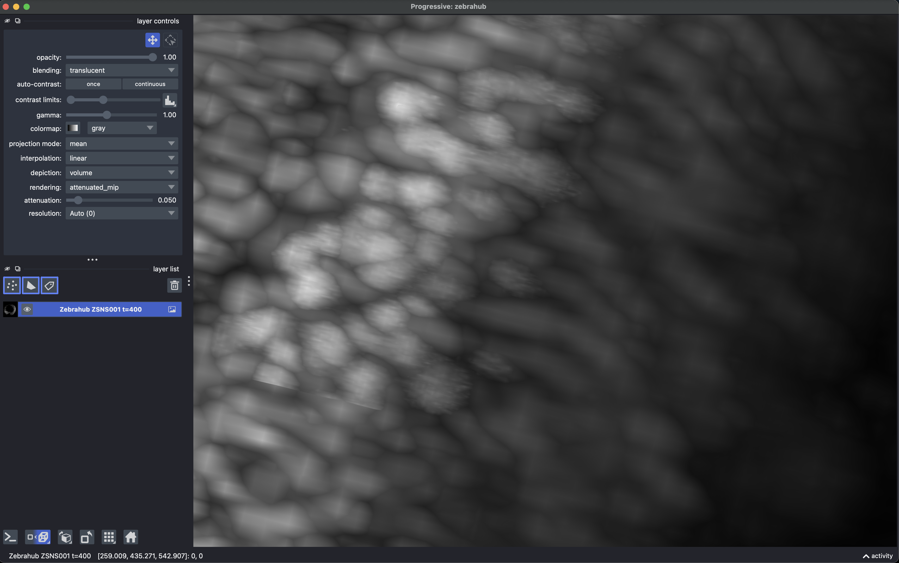
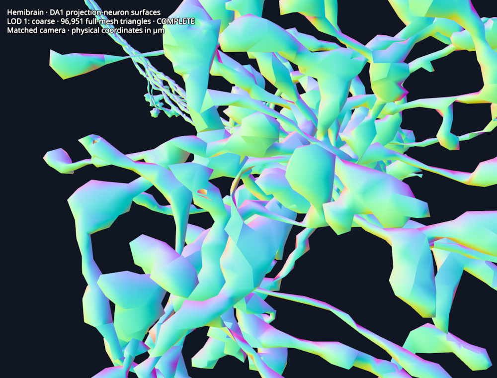
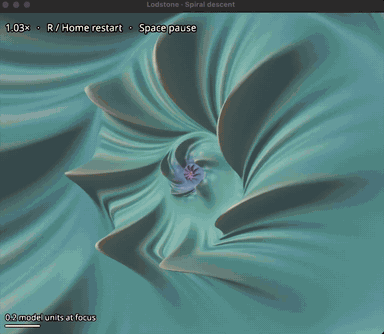

# Lodstone

Lodstone loads the parts of large images and meshes that a viewer needs.
It changes the level of detail as the camera moves and reuses data in memory.

Alpha software. The core supports Python 3.11–3.14 and requires only NumPy.

| Volume streaming | Mesh streaming |
| --- | --- |
| [](docs/viewer-demos.md#napari) | [](docs/biological-mesh.md) |

## Spiral mesh descent

Follow a perspective camera from **1× to 16,777,216×** through twelve fourfold
steps on one connected surface. The final four tiers reveal scallops, braided
ribs, flat mesas, and a toothed crown. The scale bar measures model units at
the central bud.

<details>
<summary>Animated preview</summary>

[](img/crystal/descent.mp4)

</details>

[Watch the full-speed recording](img/crystal/descent.mp4) · [Run the interactive example](docs/mesh-streaming.md#crystal-fractal)

## Install

```bash
pip install lodstone==0.1.0a6
pip install "lodstone[ome-zarr]==0.1.0a6"  # remote image data
pip install "lodstone[mesh]==0.1.0a6"      # Zarr Vectors meshes
```

Try the neuron viewer with
[uv](https://docs.astral.sh/uv/getting-started/installation/):

```bash
uv run https://raw.githubusercontent.com/kephale/lodstone/refs/heads/main/examples/biological_mesh.py
```

## Explore

| What you want to do | Start here |
| --- | --- |
| View large image volumes | [napari, ndv and ChimeraX demos](docs/viewer-demos.md) |
| Compare coarse and fine surfaces | [Neuron demo](docs/biological-mesh.md) · [Images with nucleus surfaces](docs/nessys-mesh.md) |
| Stream your own meshes | [Mesh API and installation](docs/mesh-streaming.md) |
| Connect a viewer | [Dense host API](docs/dense-hosts.md) · [SceneX adapter](src/lodstone/adapters/scenex.py) |
| Use Lodstone without a viewer | [NumPy example](examples/stream_to_numpy.py) |
| Measure a run | [Performance recording](docs/performance-telemetry.md) |

[How the planner works](docs/rendering-architecture.md) ·
[Source API](src/lodstone/source.py) · [Stream API](src/lodstone/stream.py)

## Develop

From a checkout:

```bash
uv run --extra test pytest
uv run --group dev ruff check .
uv run --extra ome-zarr --group dev pyright src
```

Tests run offline; public-data checks use explicitly prepared caches.
[Changes](CHANGELOG.md) · [Releasing](RELEASING.md)
