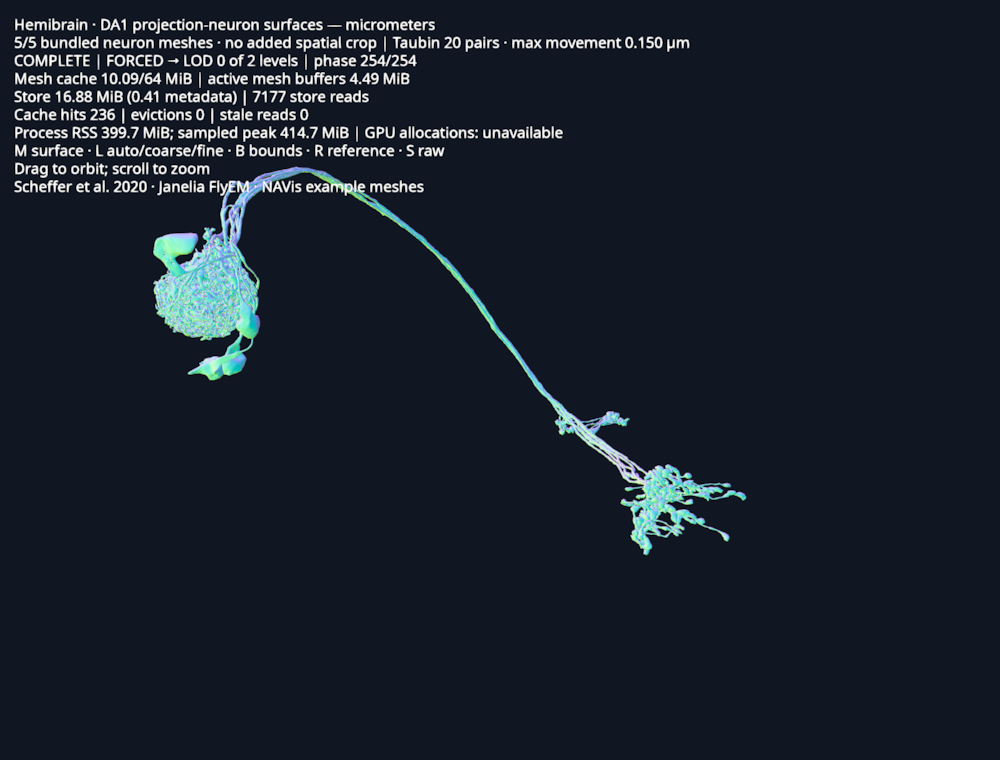
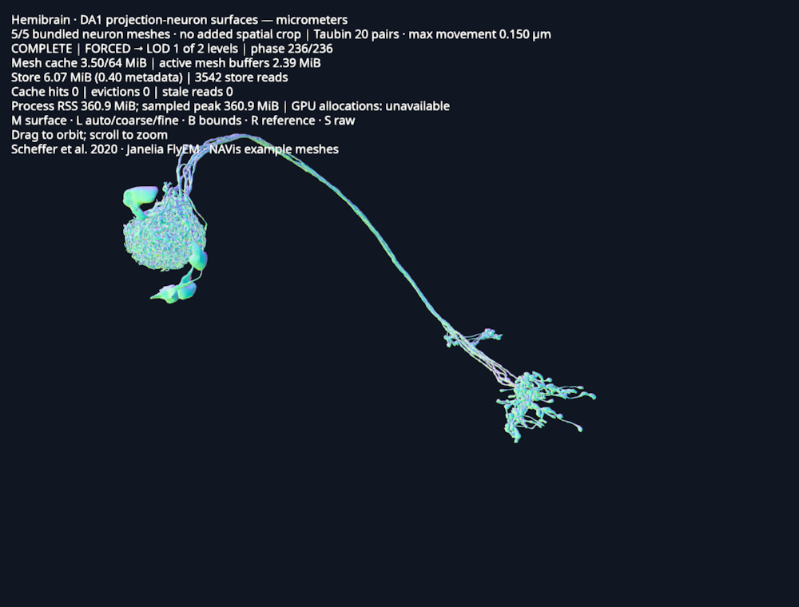

# Biological surface demo

Run on your desktop with [uv](https://docs.astral.sh/uv/getting-started/installation/) and Git:

```bash
uv run https://raw.githubusercontent.com/kephale/lodstone/refs/heads/feat/zarr-vectors-mesh-streaming/examples/biological_mesh.py
```

The default is **five Drosophila olfactory projection-neuron surface meshes**,
including their long processes and branching arbors. These are the entire five
DA1 example meshes distributed by NAVis from the Janelia hemibrain dataset.
All five are loaded, with no additional spatial crop. This is a selected example
collection, not a whole-brain dataset or proof that each biological arbor is complete.
The viewer labels that coverage explicitly.

The first launch downloads about **3.49 MB** of pinned source files and prepares
the two-level Zarr Vectors store. Constructing the constrained coarse meshes
can take a minute or two, depending on CPU speed. Progress is printed per neuron.
Later launches verify and reuse the cache. Python and
package versions are declared by the launcher; no existing project environment
is needed.

| LOD 0: fine | LOD 1: coarse |
| --- | --- |
|  |  |

## Controls

- Drag to orbit; scroll to zoom into the branching arbors.
- **L** cycles **Auto → forced LOD 1 → forced LOD 0 → Auto**.
  The overlay identifies automatic versus forced mode and shows both levels.
  The initial view may select LOD 0; zooming out selects LOD 1 when its projected
  error fits the 2-pixel threshold. The conservative selector checks all visible
  ownership-bound corners, so it can retain fine geometry longer near the camera.
- **S** switches between original source surfaces and the streamed smoothed surface.
- **R** switches between the retained smoothed reference and the streamed surface.
- **B** toggles conservative chunk ownership bounds; **M** toggles visible surfaces.

Raw and retained reference views are explicitly **unstreamed** comparison views.
Compare **R** and **S** to inspect smoothing with the same whole-object shading;
streamed chunks can have additional normal seams. The default surface streams
through the bounded mesh reader and cache. Source neuron images are not downloaded in this surface-only sample.

## Smoothing and source fidelity

The source PLY meshes are read without welding, removing faces, or changing
indices. The pinned source loader declares coordinates in units of **8 nm**;
the demo multiplies XYZ by **0.008** to display micrometers.

Twenty Taubin pairs (lambda 0.5, mu -0.53) reduce local stair steps before
chunking. Vertex displacement is capped at **0.15 µm** relative to the source.
The filter backs off per connected component to limit signed-volume change to
5% and avoid introducing local face reversals or degenerate faces. Since face
indices remain unchanged, maximum corresponding-vertex displacement also bounds
the continuous surface displacement. These are geometric checks, not a claim of
biological accuracy or a proof against self-intersections. Signed volume of an
open/nonmanifold source is only a diagnostic, not a reliable biological volume.

The original files already contain disconnected pieces, duplicate triangles,
and nonmanifold edges. Their topology is recorded without silently repairing it.
The new coarse construction protects source singularity neighborhoods: open and
nonmanifold edges, duplicate faces and disconnected vertex links. It collapses
only regular interior edges, checking connectivity and local face orientation
at each step. Protected faces retain their exact coordinates and winding.
Component count, Euler characteristic and boundary/nonmanifold-edge counts
match the fine source per neuron. These checks do not prove absence of global
self-intersections or establish biological thin-process accuracy.

- **LOD 0:** 183,763 triangles, retaining every supplied face after smoothing.
- **LOD 1:** 96,951 triangles, **47.2% fewer**.
- The continuous-surface displacement bound is below **0.5 µm**, relative to
  the **smoothed fine** reference, including float32 storage quantization.

The bound uses the actual original-to-coarse vertex map: every fine triangle
maps to a retained coarse triangle or one of its edges/vertices, and every
coarse triangle has a fine preimage. Maximum corresponding-vertex displacement
therefore bounds both continuous surfaces. This is a certificate for the
constructed meshes, not just a nearest-vertex or RMS estimate. It does not bound
an unknown biological surface. Plain unconstrained simplification changed the
source topology; those candidates remain rejected.

The [Nessys sample](nessys-mesh.md) remains available for real coarse/fine LOD,
paired fluorescence and the original diagnostics:

```bash
uv run https://raw.githubusercontent.com/kephale/lodstone/refs/heads/feat/zarr-vectors-mesh-streaming/examples/biological_mesh.py --sample nessys
```

That original fixture selects six complete nuclei; other fluorescence objects
are unmeshed. Its coverage is now explicit on screen too.

## Provenance

- [NAVis example-data origin](https://github.com/navis-org/navis/blob/4fe56c87fb8c2b0c9f89ceb3a4beb6dbf8f30839/navis/data/readme.md).
- [Pinned source loader and coordinate units](https://github.com/navis-org/navis/blob/4fe56c87fb8c2b0c9f89ceb3a4beb6dbf8f30839/navis/data/load_data.py).
- Scheffer et al. (2020), *A connectome and analysis of the adult Drosophila central brain*,
  [eLife 9:e57443](https://doi.org/10.7554/eLife.57443).
- [NAVis source repository license](https://github.com/navis-org/navis/blob/4fe56c87fb8c2b0c9f89ceb3a4beb6dbf8f30839/LICENSE).
  Source assets are fetched directly from that repository and retain their source terms.
- [Taubin (1995), A Signal Processing Approach to Fair Surface Design](https://www.cs.jhu.edu/~misha/Fall07/Papers/Taubin95.pdf).

Body IDs: **1734350788, 1734350908, 722817260, 754534424, 754538881**.
The manifest records each source URL, revision, checksum, size and coordinate
conversion. Original PLY bytes, original decoded geometry, the smoothed reference,
and encoded chunk checksums are retained in the local cache.

## Verification and diagnostics

All **183,763** supplied faces retain their original indices in the smoothed
fine reference. The check regenerates that reference from the pinned source
files and smoothing settings, then compares the oriented triangle multiset
against every streamed ownership chunk after declared float32 quantization.
This checks missing faces, duplicates and winding across chunk boundaries.
LOD 1 is independently checked against its retained coarse reference as well.
The camera replay verifies forced coarse/fine phases and automatic fine/coarse
selection after zooming. Synthetic controls cover a one-voxel bridge, duplicate
faces, an open boundary, and a bow-tie vertex beside simplifiable geometry.

[Measured source, smoothing and reference checks](../examples/data/hemibrain-reference-validation.json).

The overlay reports phase status, mesh cache and submitted buffer bytes, store
reads/bytes, process RSS and errors. Actual GPU driver allocations are unavailable.
Mesh streams use a locally prepared Zarr Vectors store; this is not a remote-mesh
network latency measurement. Submitted buffers exclude textures and driver
allocation. Normals remain fragment-local, so shading seams can still be visible.

```bash
uv run https://raw.githubusercontent.com/kephale/lodstone/refs/heads/feat/zarr-vectors-mesh-streaming/examples/biological_mesh.py --offscreen neuron-renders --diagnostic-replay
```

Use `--smooth-iterations 0` for an entirely unsmoothed streamed run, or `--cache`
to choose another cache directory. Default cache: `~/.cache/lodstone/hemibrain-neurons-v1`
(or under `XDG_CACHE_HOME`).
