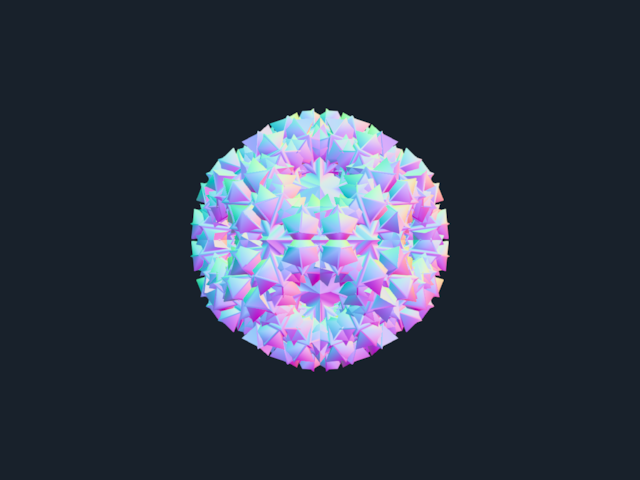
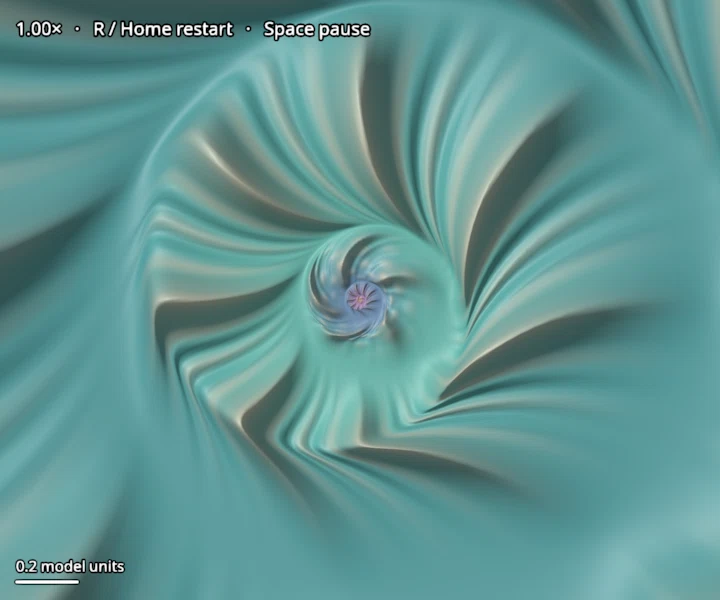
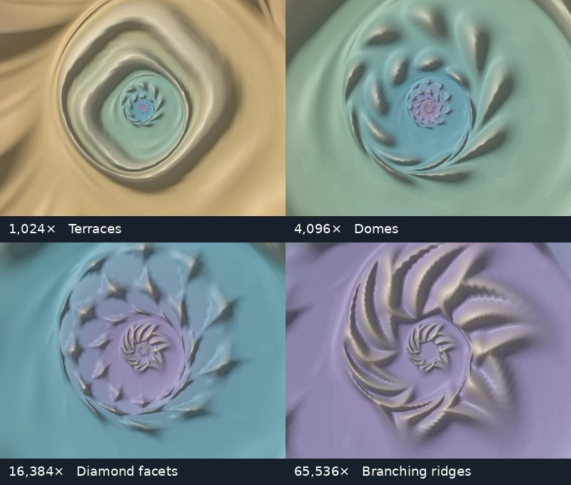

# Stream triangle meshes

Lodstone loads complete triangles for the current view, shows coarse detail
first, and replaces it with finer detail as it becomes available.
[See the neuron demo](biological-mesh.md).

## Install

From a Lodstone checkout:

```bash
pip install -e ".[mesh]"                   # headless mesh support
uv sync --frozen --extra biological-demo   # include the neuron viewer
```

The mesh extras require [Zarr Vectors 0.9.4](https://github.com/AllenInstitute/zarr-vectors-py/releases/tag/v0.9.4),
or a later 0.9 release, which include the accepted ownership reader and
scoped-link integration. The standalone demos pin 0.9.4 exactly.
The package installs from PyPI; no Git dependency or sibling checkout is needed.

## Open your own mesh

```bash
uv run --frozen --extra mesh-demo python examples/zarr_vectors_mesh.py mesh.zarrvectors \
  --levels 0 1 --errors 0 0.5 --memory-mib 128
```

Supply a justified surface-error bound for each level, in the mesh's physical
coordinate units. The values above are examples. Omit the path to try a sphere.

## Connect a viewer

Your viewer supplies a target, a 3-D `View`, and a callback dispatcher:

```python
from lodstone.mesh import MeshStream
from lodstone.sources.zarr_vectors import ZarrVectorsMeshSource

source = ZarrVectorsMeshSource("mesh.zarrvectors", level_errors=[0, 0.5])
stream = MeshStream(source, target, dispatch=run_on_viewer_thread)
stream.update(view)
```

Vertices use XYZ coordinates; set `displayed_axes=(0, 1, 2)` in the view.
The source also accepts an affine transform. Complete triangles include any
vertices they need from neighboring storage chunks.

Close the stream, then the source, when the viewer closes. A shared `Runtime`
stays open for other streams; close it last. Source cleanup waits for an active
blocking read to finish. Use `wait()` only off the GUI thread.

[Stream and target contracts](../src/lodstone/mesh.py) ·
[Zarr Vectors source](../src/lodstone/sources/zarr_vectors.py) ·
[PyGFX target](../src/lodstone/adapters/pygfx_mesh.py)

## Limits

- Raw 3-D triangles only. Draco, object filtering and mixed-LOD stitching are unsupported.
- `memory_limit` bounds decoded cache and staging data. If finer detail does not
  fit, the completed coarse surface stays visible. The whole process can use more memory.
- `max_read_bytes` checks dependency sizes before loading vertex payloads.
  It needs levels written with a verified `fragments_tile` claim; pass `None`
  for other stores.
  Metadata and decoder scratch use additional memory.
- Chunk-local normals can show shading seams. Large coordinates may need a
  camera-relative origin to preserve fine detail on the GPU.
- Actual GPU allocations and remote mesh latency remain unmeasured. The demos
  stream locally prepared stores.

## Checks

```bash
uv run --extra test pytest
```

Synthetic lifecycle and geometry tests run offline in CI. Public-data reference
checks need a prepared cache. [Neuron checks](../examples/data/hemibrain-reference-validation.json) ·
[Nessys checks](../examples/data/idr0062-reference-validation.json) ·
[Independent reader reproducer](https://github.com/AllenInstitute/zarr-vectors-py/blob/1ea7de4812ec5ad81610b42f5f58a426bf29c935/docs/upstream/mesh-streaming-review.md)

### Upstream integration check

The pinned 0.9.4 release includes the accepted ownership reader and its
scoped-link integration. Consumer validation on 2026-11-17 passed the full
Python 3.14 suite (236 tests), including the opt-in cached microscopy reference
and both neuron LOD references. Python 3.11 passed 22 headless mesh consumer tests.

The curved 4×4 tile fixture in `tests/test_mesh_seams.py` reconstructs all 32
oriented triangles exactly once. Its 40 internal edges each have two incident
faces and its 16 outer edges have one. This checks geometric continuity across
owner boundaries; it does not establish seamless lighting. The PyGFX target
still computes normals per chunk, so curved surfaces can show shading seams.

### Crystal fractal

From the checkout, run
`PYTHONPATH=src uv run --script examples/zarr_vectors_mesh.py --fractal`.
Drag to orbit and scroll to inspect the terraces and spires. Each triangular
facet grows a smaller three-sided spire, with a ring of triangles joining its
base to the surrounding surface. The viewer streams three versions of the
same crystal, generated with one, three, and five rounds of growth.
Add `--offscreen img/crystal` to render all three at the same camera position.



For a continuous descent into a spiral rosette, run
`PYTHONPATH=src uv run --script examples/zarr_vectors_mesh.py --zoom-loop`. The camera zooms from 1× to 16,777,216× into one indexed mesh and stops.
Twelve fourfold steps expose tiers with different petal counts and alternating
twist. At finer scales, rippled terraces give way to staggered domes, then diamond
facets. After the branching ridges, four deeper tiers reveal scallops, braided ribs,
flat mesas and a final toothed crown.
Vertex colors blend from teal through violet and copper, with pale ridges
under a fixed light. The perspective camera arcs around the central bud, tilting between 20°
and 40°. The ruler measures horizontal distance at the depth of that bud.

Press **R** or **Home** to restart, **Space** to pause or resume, or scroll to
move through the same range manually. Add `--offscreen img/crystal` to export
the full flight.




