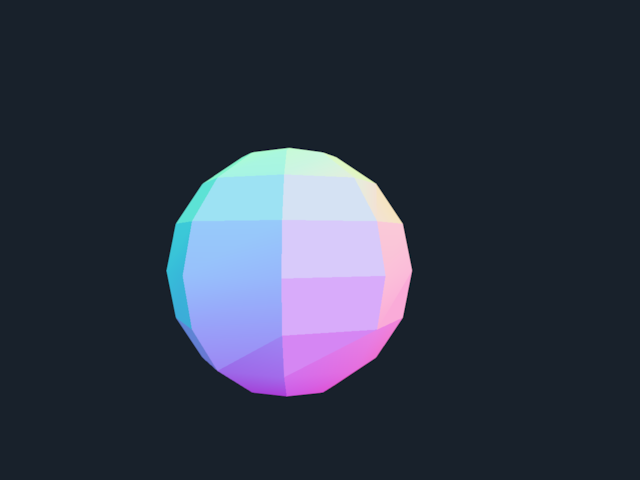

# Experimental Zarr Vectors mesh streaming

This branch adds a geometry path alongside Lodstone's array path. It reads raw
triangle meshes by stored face ownership, culls conservative fragment bounds,
streams a complete coarse level before refinement, and replaces whole phases.
The existing array Source, Planner, Stream and viewer integrations are unchanged.

## Run on another machine without an existing environment

Install [uv](https://docs.astral.sh/uv/getting-started/installation/) and Git,
then run this command in a terminal (macOS, Linux or PowerShell):

```text
uv run https://raw.githubusercontent.com/kephale/lodstone/refs/heads/feat/zarr-vectors-mesh-streaming/examples/zarr_vectors_mesh.py
```

The script declares its own Python version and pinned dependencies, including
both repository revisions. uv creates an isolated environment and downloads
Python if needed; no manual environment setup or repository clones are needed.
First launch needs internet access. Use a local desktop with working graphics
drivers. Drag to orbit and scroll to zoom between levels of detail.

For images instead of a window, append `--offscreen mesh-renders` to the command.
This saves the two PNGs and metrics in a `mesh-renders` folder. The built-in
fixture is a synthetic sphere, not a biological dataset.

## Install the two branches

Clone the repositories next to each other:

```bash
git clone --branch feat/bounded-mesh-reads https://github.com/kephale/zarr-vectors-py.git
git clone --branch feat/zarr-vectors-mesh-streaming https://github.com/kephale/lodstone.git
cd lodstone
uv sync --extra mesh-demo --group dev
uv pip install --python .venv/bin/python -e ../zarr-vectors-py
.venv/bin/python examples/zarr_vectors_mesh.py
```

The local editable install is necessary until `building.MeshReader` is accepted
and released upstream. A released `zarr-vectors` without that API fails with an
explicit installation message. Running `uv sync` again may replace the editable
install; repeat the final installation command afterward.

The locally validated integration uses reader revision
`40bd38045e0c23019c5c88a54824b89f89243e4e`. To reproduce that revision instead
of an editable checkout, use:

```bash
uv pip install --python .venv/bin/python \
  "zarr-vectors @ git+https://github.com/kephale/zarr-vectors-py@40bd38045e0c23019c5c88a54824b89f89243e4e"
```

The default example generates two explicit tessellations of one analytic sphere.
It does not claim to validate a scientific mesh or a decimation algorithm. Drag
to orbit and zoom to change the selected LOD. A desktop OpenGL/Vulkan environment
and a GLFW-compatible display are needed for the interactive window.

For a reproducible offscreen render:

```bash
.venv/bin/python examples/zarr_vectors_mesh.py --offscreen /tmp/lodstone-mesh
```

This writes a PNG per level and `metrics.json` with read counts, retained array
bytes, submitted render-buffer bytes and whether the memory limit was reached.

These are actual offscreen renders of the generated two-level fixture:

| Coarse surface | Fine surface |
| --- | --- |
|  |  |

For an existing dataset:

```bash
.venv/bin/python examples/zarr_vectors_mesh.py /path/to/surface.zarrvectors \
  --levels 0 1 2 --errors 0 0.1 0.5 --memory-mib 128
```

Those errors are examples, in the dataset's physical coordinate units. Supply
errors justified for the actual surfaces. Bin size, object thinning and level
number do not establish geometric error. Every selected level must contain raw
triangle connectivity; a metavertex-only pyramid is rejected.

## Interfaces and ownership

`lodstone.mesh` provides MeshChunk, MeshLevel, MeshData, MeshSource, MeshTarget,
MeshStream and camera-based selection helpers. `ZarrVectorsMeshSource` is in
`lodstone.sources.zarr_vectors`; `PyGFXMeshTarget` is in
`lodstone.adapters.pygfx_mesh`. Imports of the optional packages are deferred.

Mesh vertices use XYZ order in their stored coordinate frame. An optional
explicit affine transform maps both vertices and culling bounds into viewer
space. `View` must use `displayed_axes=(0, 1, 2)`. No implicit voxel-size or
multiscale-bin transform is applied to already physical coordinates.

The companion reader assigns each face to its stored canonical source cell.
Disjoint owner selections therefore partition faces. A read fetches the vertex
chunks referenced by those faces, including neighbors outside the selected
owners. Culling bounds conservatively include these dependency chunks, so a
triangle is not culled just because its owner cell is outside the view.

The stream serializes source reads, shares Runtime when supplied, caches decoded
fragments with eviction, and checks generation again on the render thread.
Superseded blocking reads finish before the next source read starts; they are
not published. GUI hosts must provide a dispatcher and keep servicing it.
`wait()` is for tests/background work, never the GUI thread. Close the stream
and target before closing a shared Runtime.

## Memory and failure semantics

`MeshStream.memory_limit` caps retained cache/staging arrays. Each complete
phase must fit. If refinement does not fit, the completed coarse phase stays
visible and `limited` is set; an oversized initial phase raises MemoryError.
Other source/render failures remain observable through `error` and `wait()`.

`ZarrVectorsMeshSource.max_read_bytes` additionally checks the decoded dependency
vertex size and face size before fetching vertex payloads. The upstream reader
must first read owned connectivity and small fragment indices to calculate it.
Only one source read is in flight. PyGFX separately caps submitted position,
index and normal buffers and removes old meshes on replacement.

These are separate limits, not a process-RSS guarantee: displayed buffers may
coexist with staged arrays; connectivity decoding, remapping, normal generation,
one incoming chunk, metadata, and driver scratch/deferred destruction add memory.
Actual GPU allocations and process peak memory have not been instrumented.

## Current exclusions and next validation

- Draco, quads, object-ID selection, mesh editing and mixed-LOD stitching are
  excluded. No new mesh decimator is provided.
- Metadata discovery lists connectivity cells for the selected levels; that
  index is not itself an out-of-core hierarchy.
- Network-store latency, real scientific datasets, thin-structure preservation,
  and interactive desktop behavior need further validation. Offscreen renders
  and synthetic geometry tests establish a narrower result.
- Generated normals are fragment-local, so shading may differ across chunk
  boundaries even though the geometry is complete. Upstream normal/attribute
  streaming is a separate task.
- PyGFX submits float32 vertex positions; very large absolute coordinates with
  fine detail need a camera-relative origin strategy before precision claims
  can be made. The source preserves its transformed float64 coordinates.

Next use a pinned public scientific mesh with existing valid surface levels.
Check complete ownership against the full mesh, physical alignment with its
image volume, read amplification during camera motion, and measured peak memory.
