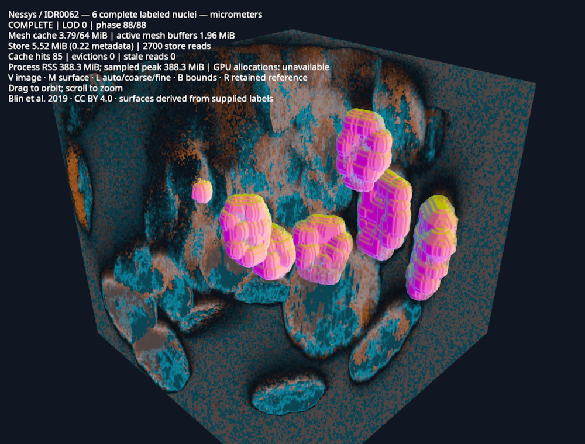

# Images with nucleus surfaces

View fluorescence alongside six selected nucleus surfaces from IDR0062.
Other objects remain visible in the image but are not meshed.



## Run

With [uv](https://docs.astral.sh/uv/getting-started/installation/) and Git:

```bash
uv run https://raw.githubusercontent.com/kephale/lodstone/refs/heads/feat/zarr-vectors-mesh-streaming/examples/biological_mesh.py --sample nessys
```

**V** toggles the image, **L** cycles Auto/coarse/fine, **B** shows chunk bounds,
and **R** compares the retained reference. Drag to orbit; scroll to zoom.
First-run downloads and preparation are cached.

## Data and checks

[Blin et al. (2019)](https://doi.org/10.1371/journal.pbio.3000388),
[IDR0062 image 6001240](https://livingobjects.ebi.ac.uk/idr/zarr/v0.4/idr0062A/6001240.zarr),
[CC BY 4.0](https://creativecommons.org/licenses/by/4.0/).
The image and supplied labels share physical coordinates in micrometers.

The fine surface has 81,566 triangles; the coarse surface has 24,466.
The saved checks compare streamed faces with the reference and record topology,
alignment and LOD error. They do not independently validate the segmentation.

[Geometry checks](../examples/data/idr0062-reference-validation.json) ·
[Read and memory measurements](../examples/data/idr0062-diagnostics.json) ·
[Earlier read baseline](../examples/data/idr0062-diagnostics-baseline.json) ·
[Chunk-bounds view](../img/biological-mesh-bounds.png) ·
[Memory limits](mesh-streaming.md#limits)
