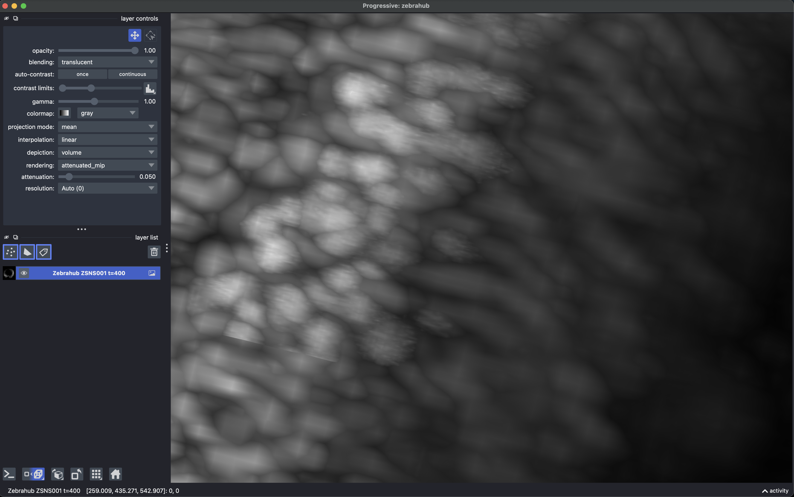
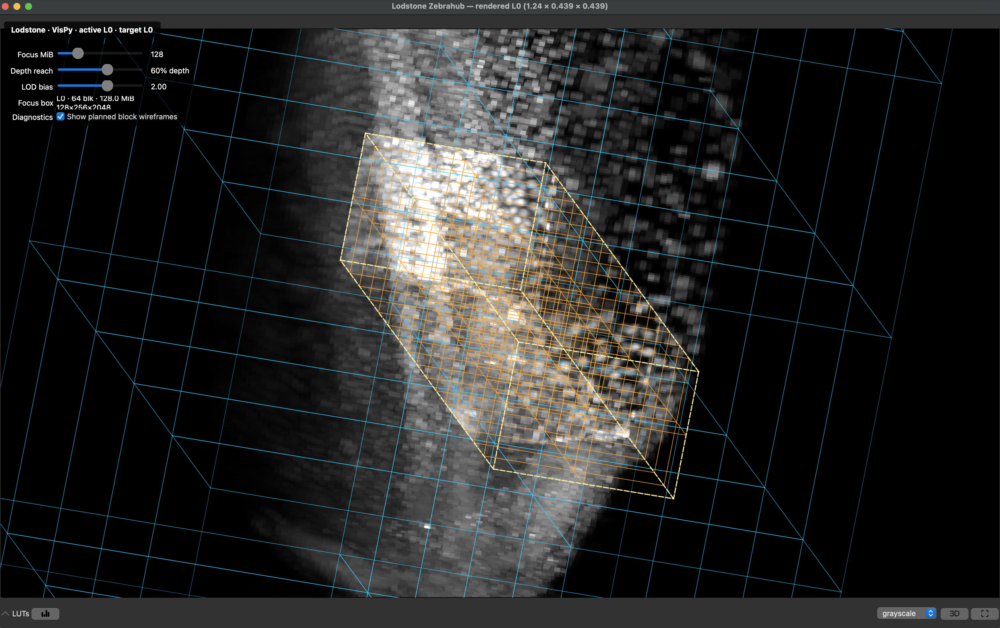
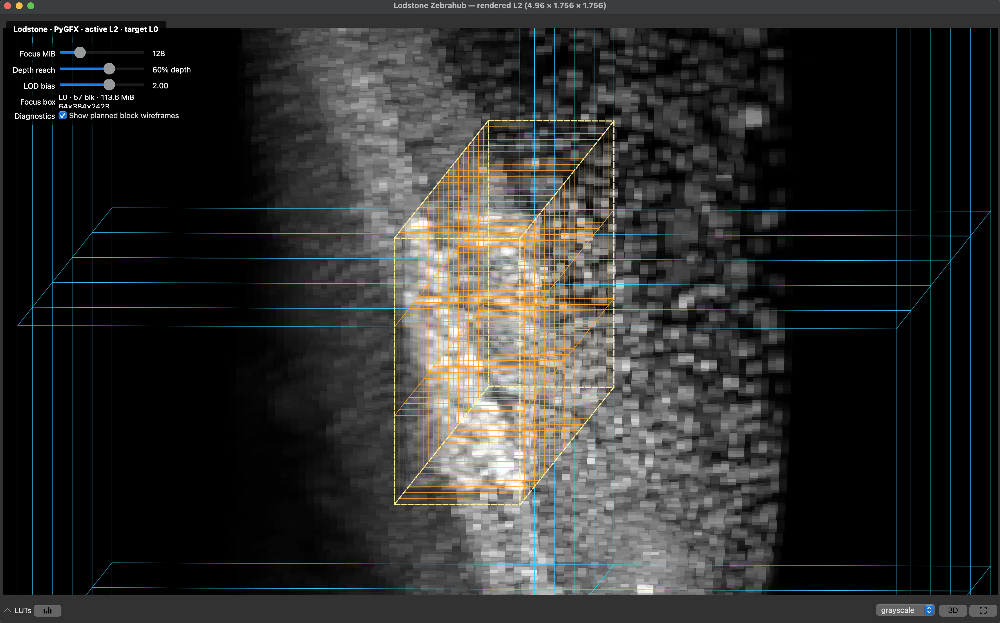
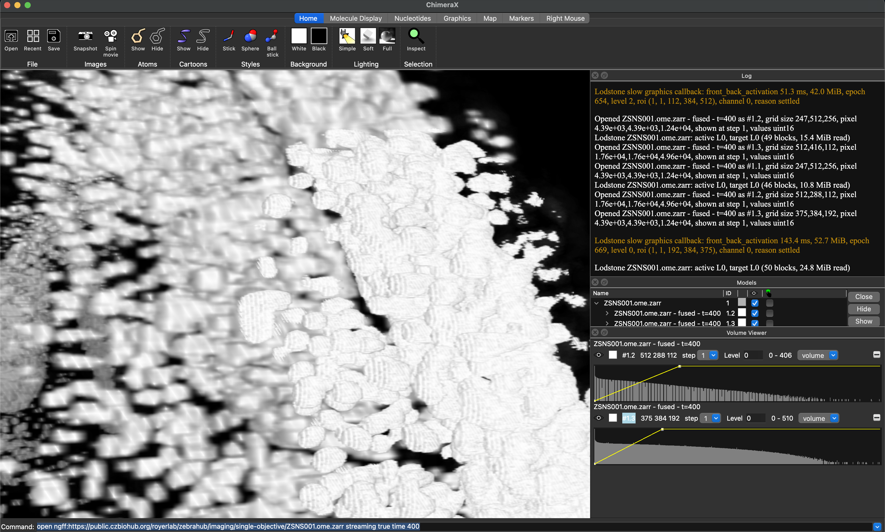

# Volume viewer demos

Clone Lodstone, then choose a viewer below:

```bash
git clone --depth 1 https://github.com/kephale/lodstone.git
cd lodstone
```

All commands use the public ZSNS001 Zebrahub light-sheet dataset at timepoint
400. Clone the viewer repositories next to `lodstone`, giving this layout:

```text
work/
├── lodstone/
├── napari/
├── ndv/
└── chimerax-ome-zarr/
```

## napari

```bash
cd ..
git clone --depth 1 --single-branch --branch lodstone-integration \
  https://github.com/kephale/napari.git
cd napari
python3 -m venv .venv
.venv/bin/python -m pip install -e ".[pyqt6,progressive]"
.venv/bin/python -m pip install -e "../lodstone[ome-zarr]"

cd ../lodstone
../napari/.venv/bin/python examples/napari_zebrahub.py \
  --time 400 --ndisplay 3
```

Add `--trace-chunks` to log plans, cache hits, source reads, and evictions, or
`--diagnostic-levels` to color pixels by the pyramid level that supplied them.

[](../img/lodstone_napari.png)

## ndv

```bash
cd ..
git clone --depth 1 --single-branch --branch lodstone-integration \
  https://github.com/kephale/ndv.git
cd ndv
python3 -m venv .venv
.venv/bin/python -m pip install -e ".[pyqt,vispy,pygfx]"
.venv/bin/python -m pip install -e "../lodstone[ome-zarr]"

cd ../lodstone
../ndv/.venv/bin/python examples/ndv_dense.py \
  --backend vispy --time 400
```

Close the VisPy window, then run the identical data path with PyGFX:

```bash
../ndv/.venv/bin/python examples/ndv_dense.py \
  --backend pygfx --time 400
```

| VisPy | PyGFX |
| --- | --- |
| [](../img/lodstone_ndv_vispy.png) | [](../img/lodstone_ndv_pygfx.png) |

## ChimeraX

The ChimeraX integration is provided by the OME-Zarr bundle's streaming
branch. The commands below use ChimeraX Daily on macOS; adjust
`CHIMERAX_PYTHON` and `CHIMERAX` for another installation.

```bash
cd ..
git clone --depth 1 --single-branch --branch codex/lodstone-streaming \
  https://github.com/kephale/chimerax-ome-zarr.git
cd chimerax-ome-zarr

export CHIMERAX=/Applications/ChimeraX_Daily.app/Contents/bin/ChimeraX
export CHIMERAX_PYTHON=/Applications/ChimeraX_Daily.app/Contents/bin/python3.14

"$CHIMERAX_PYTHON" -m pip install --no-deps --force-reinstall ../lodstone
PYTHONPATH="$PWD" "$CHIMERAX_PYTHON" -m chimerax.core --nogui --exit \
  --cmd "devel build ."
"$CHIMERAX_PYTHON" -m chimerax.core --nogui --exit --cmd \
  "toolshed install $PWD/dist/chimerax_ome_zarr-1.0.0a1-py3-none-any.whl noDeps true reinstall true"

"$CHIMERAX" --cmd \
  "open ngff:https://public.czbiohub.org/royerlab/zebrahub/imaging/single-objective/ZSNS001.ome.zarr streaming true"
```

Restart ChimeraX after replacing Lodstone or reinstalling the bundle.

[](../img/lodstone_chimera_ome_zarr.png)


[Connect another viewer](dense-hosts.md) · [Mesh demo](biological-mesh.md)
